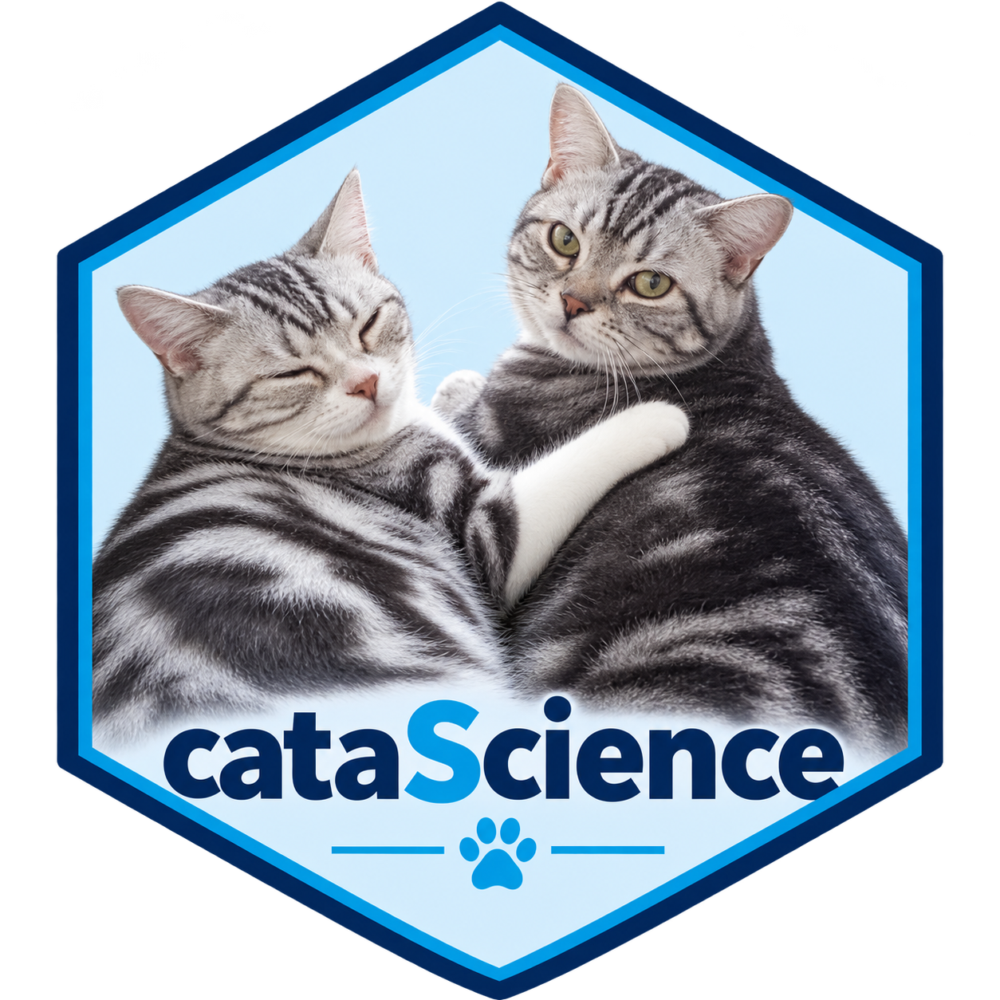

# cataScience <a href="https://shanlong-who.github.io/cataScience/"></a>

<!-- badges: start -->
[](https://cran.r-project.org/package=cataScience)
[](https://lifecycle.r-lib.org/articles/stages.html#stable)
[](https://cran.r-project.org/package=cataScience)
[](https://github.com/shanlong-who/cataScience/actions/workflows/R-CMD-check.yaml)
<!-- badges: end -->

**A Journey of Data Science** — an interactive training app for people who
are new to data: import → clean → visualize → understand, with AI as your
assistant and you as the judge.

Developed for WHO data trainings (Global Health Learning Center and
country-office sessions), but the content is general: anyone learning data
science or starting to use AI assistants at work can use it for self-study.

Documentation: <https://shanlong-who.github.io/cataScience/>

[Open the cat café classroom](https://shanlong-who.github.io/cata/)

The online app runs R in your browser with Shinylive. No R installation is
needed; allow time for the runtime and packages to download on the first
visit. kNN imputation requires the local R app and the optional VIM package.

## Guides

| Guide | What you will learn |
|---|---|
| [Getting started](https://shanlong-who.github.io/cataScience/articles/cataScience.html) | Launch the app, follow the module map and use the example data |
| [Data-quality workflow](https://shanlong-who.github.io/cataScience/articles/data-quality-workflow.html) | Compare cleaning choices, inspect text and joins, and explain a chart |

Use the online classroom or launch it from R.

## Installation

```r
install.packages("cataScience")
```

or

```r
# install.packages("remotes")
remotes::install_github("shanlong-who/cataScience")
```

## Usage

```r
library(cataScience)
run_cata()
```

The classroom opens in English or Simplified Chinese. Use `run_cata(language = "zh")` to start in Chinese, or switch languages in the navigation bar.

Load the two original cat workbooks in Import. Compare four joins on separate two-row tables in **Cleaning → Merge → Methodology**.

## Reusable functions

The package can also be used without launching Shiny:

```r
library(cataScience)

measurements <- cata_example("cats")
personalities <- cata_example("cats2")
cata_missing(measurements)
cata_check_keys(measurements, "id")
joined <- cata_join(measurements, personalities, by = "id")
joined$audit
```

Other helpers include `cata_read()`, `cata_flag_outliers()`,
`cata_proportion()`, `cata_count_status()`, `cata_mice_demo()`,
`theme_cata()` and `cata_export()`. Use `?function_name` for arguments and
worked examples. Flagging a value does not delete or replace it.

## Dependencies

- **mice** remains required: the complete-data cat Easter egg is preserved,
  and the optional cat lesson demonstrates predictive mean matching, completed
  datasets, chain diagnostics and pooled model estimates.
- **VIM** is optional and used only for its existing kNN imputation. Install
  it with `install.packages("VIM")` to enable that choice. Missingness
  patterns use `mice::md.pattern()`.
- **rio** is removed. Excel uses readxl; CSV uses readr.
- **naniar** and **skimr** remain required for missingness demonstrations and
  compact data summaries in the original app.
- **DSIR** is optional. Install it to choose `style = "dsi"` in `cata_plot()`. The app also has a built-in theme.

The app opens in your browser. Everything runs locally — no internet
connection is needed after installation.

Start with **Import → Or use the example data**, then follow **Cleaning →
Missing data**, **Cleaning → Outliers**, **Visualize** and **Quiz**.
Use **Reset to original data** to compare cleaning choices.

Use RStudio's Stop button or Escape in the console to stop the app.
Live demonstrations with an external AI assistant need internet access.

## What is inside

| Module | Content |
|---|---|
| Import | Upload Excel/CSV files, or use the bundled example data |
| Cleaning | Missing data (MCAR/MAR/MNAR, imputation), outliers, text, merging |
| Visualize | Seven chart types, category sorting, two cat-chart comparisons and a one-page HTML report |
| Statistics | Describing data, normal distribution, t-test, regression |
| AI | Prompting levels, four practical AI tasks, AI-assisted analysis, a methods case study and AI safety |
| Quiz | 27 questions with per-session topic filters |

## Development

Reusable functions live under `R/`; Shiny modules and teaching materials
live under `inst/app/`. From this source checkout, use
`pkgload::load_all()` and then `run_cata()` to try changes. Run
`devtools::test()` and `devtools::check()` before a release. The existing
installed package is unchanged until you install the new version.

## Contact

Shanlong Ding — dings@who.int
