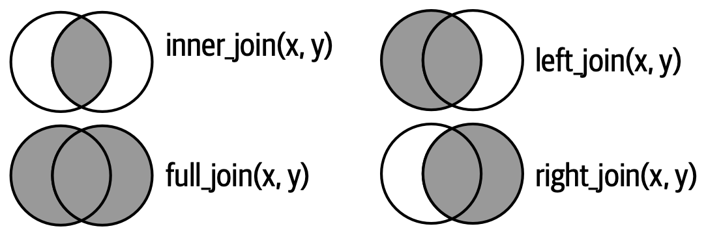

## Potential problems

- Wrong join keys = chaos.

  If you match on the wrong variable (e.g., matching on age instead of
  cat ID), you may merge cats that have the same age but are different
  cats — and that’s bad.

- Duplicates cause explosion.

  One-to-many or many-to-many joins can cause row numbers to
  unexpectedly explode.

- Different variable names? No problem.

  My dashboard allows you to select key1 and key2 to map mismatched
  column names!
