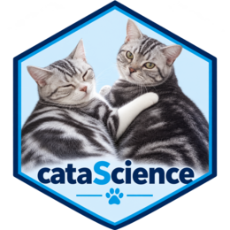

```{r, include=FALSE}
knitr::opts_chunk$set(collapse = TRUE, comment = "#>", message = FALSE,
                     warning = FALSE, fig.width = 7.2, fig.height = 4.5)
```

```{r setup}
library(cataScience)
```



**cataScience** launches **A Journey of Data Science**, an interactive
training app for people who are new to working with data. Its learning path
is import → clean → visualize → understand. The AI pages help you describe a
task, check an assistant's work and keep responsibility for the result.

Most activities use buttons, tables and charts. You do not need to write R
code to complete the app exercises. The optional R examples in these
vignettes show how to reproduce a few of the ideas outside the app.

## Install and launch

Install the released package from CRAN:

```{r installation, eval=FALSE}
install.packages("cataScience")
```

Or install the development version:

```{r development-installation, eval=FALSE}
install.packages("remotes")
remotes::install_github("shanlong-who/cataScience")
```

Run this in the RStudio console:

```{r launch, eval=FALSE}
library(cataScience)
run_cata()
```

The app opens in your browser and runs in the local R session. After
installation, the bundled lessons and data activities work offline. Live
demonstrations with an external AI assistant need internet access and an
account with that service.

The documentation website contains guides and the function reference.
The [online classroom](https://shanlong-who.github.io/cata/) runs in your browser. The first visit downloads the R runtime and packages.

The R console stays busy while the app runs. Use RStudio's Stop button or
press Escape in the console to stop it. Closing the browser tab may leave
the R session running.

```{r launch-options, eval=FALSE}
run_cata(launch.browser = FALSE, port = 3838)
```

For this option, open `http://127.0.0.1:3838` yourself. Choose a different
port if it is already in use.

## Your first learning session

1. Open **Home** and read the data science workflow.
2. Open **Import** and click **Or use the example data** for Dataset 1.
3. Inspect the preview: rows, columns, data types and missing values.
4. Open **Cleaning → Missing data** and compare two choices before applying
   a change. Select the variables you intend to change.
5. Open **Cleaning → Outliers** and discuss whether a flagged value is an
   error or a valid observation.
6. Open **Visualize** and choose a chart that answers one clear question.
7. Open **Quiz**, select the topics you covered, and click **Apply topics
   and restart**.

Use **Reset to original data** to return to the imported dataset when
comparing cleaning choices. Changes applied to a dataset feed later
activities in the same session. Reloading or restarting the app starts a
new session; keep your original exercise files for the next session.

Follow [A guided data-quality workflow](data-quality-workflow.html) for a
complete lab with questions and reproducible R examples.

## The module map

| Module | What you practise |
|---|---|
| Import | Load one or two Excel/CSV files, or use the example data; inspect the preview |
| Cleaning → Missing data | Row removal, filling values, mean or median replacement, and kNN imputation |
| Cleaning → Outliers | Inspect the IQR rule; compare removal and winsorizing |
| Cleaning → Text | Select character variables and standardize letter case |
| Cleaning → Merge | Choose matching keys and a left, right, inner or full join |
| Visualize | Seven chart types, category sorting, two cat-chart comparisons and a one-page HTML report |
| Statistics | Describing data, the normal distribution, t-tests and regression |
| AI | Prompting levels, four practical tasks, AI-assisted analysis, a methods case study and safety |
| Quiz | Topic filters, explanations and a final exercise |

The **Background**, **Type**, **Methodology** and **Principles** tabs provide
short explanations alongside the hands-on pages. You can return to them
when a practical choice needs more context.

## Work with your own files

The Import page accepts `.csv`, `.xlsx` and `.xls` files. For an Excel
exercise, use a workbook with one sheet. Prepare a rectangular table with
one header row, one variable per column and one observation per row.

Upload one file for most activities. Upload a second file when practising
joins, and check the matching keys before merging. Avoid notes, merged
cells and embedded totals within the data table.

The Home page's **Download datasets** button provides the bundled exercise
files. You can also find the package's primary teaching workbook from R:

```{r example-file}
example_file <- system.file(
  "app", "data", "cat-dirty-data.xlsx", package = "cataScience"
)
file.exists(example_file)
```

Load both cat tables. Under **Cleaning → Outliers → Dataset 1 → Verify a source record**,
check Trevor’s length and Stanley’s weight against the café records. Enter the
verified value and identify the source. The same editor under **Missing data**
accepts a missing measurement when a source confirms it. The original import
and correction history remain available during the session.

Join the tables by `id` and apply the join. In **Visualize → Compare charts**,
compare counts with group percentages or mean weights with individual cats.
Later corrections also update the applied join and its charts. Open
**Communicate your finding** beneath a chart, enter one finding and one
limitation, then download the self-contained HTML page.

## Use the AI pages

Start with **AI → Prompting levels**, then try one of the **Four AI tasks**.
Give the assistant a clear task, relevant context, an expected
output and criteria for checking it.

Use **AI-assisted analysis** to review data and claims. The **When AI gets
it wrong** case study shows why the current indicator methodology must be
checked against its source. The app presents teaching material; it does
not call an AI service or send your uploaded data to an AI assistant.


## Common questions

| Question | Answer |
|---|---|
| Do learners need R? | The online edition does not; the package edition needs R. A portable Windows edition is available separately from the maintainer |
| Can I use it offline? | Yes, for the bundled lessons and data activities; external AI demonstrations need connectivity |
| Why is the preview empty? | Load a file or click the example-data button on Import first |
| How do I undo cleaning? | Click Reset to original data, then try another method |
| Why did the quiz start again? | Applying a new topic selection resets that session's questions and score |

```{r package-version}
packageVersion("cataScience")
```

Report problems at the
[cataScience issue tracker](https://github.com/shanlong-who/cataScience/issues).
Include the package version, the page you used and the R console error.
