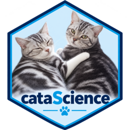

# cataScience 快速入门

``` r

library(cataScience)
```



**cataScience** 启动 **A Journey of Data
Science**，帮助初学者学习导入、清理、可视化和理解数据。AI
课程帮助你描述任务、检查助手的工作，并对结果承担责任。

主要练习通过按钮、表格和图表完成，无需编写 R 代码。指南中的 R
示例用于展示如何在应用外复现相关分析。

## 选择在线版或本地版

无需安装
R，可直接打开中文版的[扩展培训版](https://shanlong-who.github.io/cata/?lang=zh)或[经典版](https://shanlong-who.github.io/cata/classic/?lang=zh)。首次访问会下载运行环境和
R 包，请保持页面打开并查看进度。进入课堂后，点击顶部的 **English** 或
**中文** 即可切换语言。

如需稳定的离线课堂环境，可在 RStudio
中使用本地包。安装完成后，内置课程和数据练习无需联网；与外部 AI
助手互动的演示仍需网络和相应账户。

## 安装与启动

从 CRAN 安装正式版：

``` r

install.packages("cataScience")
```

或安装 GitHub 当前版本：

``` r

install.packages("remotes")
remotes::install_github("shanlong-who/cataScience")
```

在 RStudio 控制台中启动经典版：

``` r

library(cataScience)
run_cata()
```

2.2 版的扩展培训入口连接公共卫生案例、数据准备、图表和结果沟通：

``` r

run_catas()
```

应用会在浏览器中打开，但实际运行于本地 R 会话。应用运行时 R
控制台保持忙碌；使用 RStudio 的 Stop 按钮或在控制台按 Escape
停止。仅关闭浏览器标签页可能不会终止 R 会话。

也可以手动指定端口：

``` r

run_cata(launch.browser = FALSE, port = 3838)
```

随后自行打开 `http://127.0.0.1:3838`。如果端口被占用，请换一个端口。

## 第一次学习

1.  在 **Home** 阅读数据科学工作流；扩展版先从 **Why data matters**
    开始。
2.  打开 **Import**，在 Dataset 1 中点击 **Or use the example data**。
3.  检查数据预览：行、列、变量类型和缺失值。
4.  打开 **Cleaning → Missing
    data**，先比较两种方法，再应用修改；明确选择要修改的变量。
5.  打开 **Cleaning → Outliers**，讨论被标记的值是错误还是有效观测。
6.  打开 **Visualize**，选择能回答一个明确问题的图表。
7.  打开 **Quiz**，选择本次所学主题，点击 **Apply topics and restart**。

比较清理方法时，使用 **Reset to original data**
恢复导入的数据。同一会话中的清理结果会进入后续活动。重新加载或重新启动应用会开始新会话，请保留原始练习文件。

继续阅读[数据质量工作流](https://shanlong-who.github.io/cataScience/zh/articles/data-quality-workflow.md)，完成包含讨论问题和可复现
R 示例的练习。

## 模块导航

| 模块 | 练习内容 |
|----|----|
| Import | 加载一到两个 Excel/CSV 文件或示例数据，检查预览 |
| Cleaning → Missing data | 删除行、向上或向下填充、均值或中位数替换；本地版可选 kNN |
| Cleaning → Outliers | IQR 规则、删除异常值与缩尾处理 |
| Cleaning → Text | 选择字符变量并统一大小写 |
| Cleaning → Merge | 选择关联键，进行左、右、内或全关联 |
| Visualize | 柱状图、直方图、密度图、折线图、饼图、散点图和箱线图 |
| Statistics | 数据描述、正态分布、t 检验和回归 |
| AI | 提示词层次、提示词库、辅助分析、方法错误案例及安全使用 |
| Quiz | 主题筛选、答案解释和最终练习 |
| Training | 教师手册和图片来源 |

扩展版另有 **Workflow**，提供带记录的数据准备、11 类图表，以及报告和
dashboard 导出。**Background**、**Type**、**Methodology** 和
**Principles** 标签提供实践背后的简短解释。

## 使用自己的文件

Import 接受 `.csv`、`.xlsx` 和 `.xls`。初次 Excel
练习建议使用单工作表文件：第一行为变量名，每列一个变量，每行一个观测。避免在数据区域放置备注、合并单元格和汇总行。

多数活动只需上传一个文件；练习关联时再上传第二个文件，并先检查关联键。

经典版 Home 的 **Download datasets** 可获取练习文件。也可以在 R
中找到主教学工作簿：

``` r

example.file <- system.file(
  "app", "data", "cat-dirty-data.xlsx", package = "cataScience"
)
file.exists(example.file)
#> [1] TRUE
```

第一次清理练习建议使用猫咪数据，先关注数据处理决策，再进入卫生指标解释。

## 使用 AI 课程

先阅读 **AI → Prompting levels**，再从 **Prompt gallery**
选择并修改提示词。向助手提供明确任务、相关背景、预期输出和检查标准。

**AI-assisted analysis** 用于审阅数据与结论；**When AI gets it wrong**
展示为什么必须回到来源核对当前指标方法。应用只展示教学材料，不调用 AI
服务，也不会把上传的数据发送给 AI 助手。

组织培训时，可参阅[培训指南](https://shanlong-who.github.io/cataScience/zh/articles/training-guide.md)。

## 常见问题

| 问题 | 回答 |
|----|----|
| 学员需要安装 R 吗？ | 在线版不需要；本地包需要 R。维护者还可另行提供 Windows 便携版 |
| 可以离线使用吗？ | 本地版的内置课程与数据活动可以；外部 AI 演示需要联网 |
| 在线页面一直等待怎么办？ | 查看启动进度和错误详情，检查网络后重试；网络受限时使用本地版 |
| 为什么数据预览为空？ | 先在 Import 上传文件或点击示例数据按钮 |
| 如何撤销清理？ | 经典版使用 Reset to original data；扩展版 Workflow 还提供撤销和重置 |
| 为什么测验重新开始了？ | 应用新的主题筛选会重置本次会话的题目和分数 |
| 为什么没有 kNN？ | 在线版不提供；本地版需要另行安装 VIM |

``` r

packageVersion("cataScience")
#> [1] '2.2.0'
```

如遇问题，请在 [cataScience issue
tracker](https://github.com/shanlong-who/cataScience/issues)
说明包版本、所在页面和错误信息。
