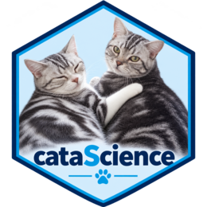

# 数据科学与 AI 培训指南

``` r

library(cataScience)
```



cataScience
可用于教师带领的培训或自学。根据学员背景与时间选择模块，用应用演示，再让学员独立操作。本指南根据包内教师手册和实验材料整理。

## 扩展培训版

[`run_catas()`](https://shanlong-who.github.io/cataScience/zh/reference/run_catas.md)
启动连贯的扩展工作流，[`run_cata()`](https://shanlong-who.github.io/cataScience/zh/reference/run_cata.md)
启动经典版，两个入口都保留。

老挝培训可从 **Why data matters**
开始：先让学员预测结果，再揭示分母；讨论 Snow
地图能够和不能够支持的判断；检查数据集 A 的服务级联。A
的地区汇总数独立于 B/C 的合成个人记录。

在 **Workflow** 中加载 **Dataset B: reference with
flags**，阅读代码本、检查键，再关联机构表。声明为“多对一”的关联保留 604
条记录，其中两条没有匹配。**Apply course S7 selection** 保留 587
条记录。比较 Yes/No 分母与全部选定记录，并让 Unknown
和空白继续可见。每一步保留样本数与代码，支持撤销。

**Statistics → Public health example** 的固定示例复现课程中的
604、604、587、582、577 和 575
个样本数。卡方检验与回归使用不同的明确分母；所有回归模型使用相同的 575
条预测变量完整记录，以 Female 和 Health Center
为参照。解释区间之前，应讨论选择过程、函数形式及机构内相关性。

使用 **Cleaning → Multiple imputation**
比较完整合成数据、完整案例、均值替换和多重插补合并结果，查看完成的数据与迭代链。链看起来稳定，不能证明真实研究中的缺失机制假设正确。

在 **Workflow → Visualise**
用相同汇总数据比较柱状图与排序点图。请学员先写出有依据的发现和局限，再进入
**Communicate**。HTML 报告和 dashboard 可离线打开；项目 ZIP
包含原始输入快照、选定记录、整理代码、RStudio 项目以及 Quarto 和 Shiny
源文件。分享前检查其中数据；在导出项目目录重新运行 `analysis.R`
检查可复现性。数据改变后，文字结论仍需人工审阅。

独立的 AI 图表练习应向各工具提供相同的合成数据和问题，再与 R
输出比较数值、分母、刻度及强调的信息。应用本身不要求 AI 服务或 API
密钥。

出行前安装所需包，可选安装 VIM 和
DSIR；断网后测试两个本地入口与导出功能。现成的 HTML 导出不需要 Quarto。

## 按学习目标选择模块

| 目标 | 建议模块 | 学习成果 |
|----|----|----|
| 分析前检查数据 | Import、Missing data、Outliers | 解释一个数据问题和合理处理方式 |
| 传达发现 | Visualize、Describing data | 选择图表，并说明分母和局限 |
| 理解统计比较 | Normal distribution、t-test、Regression | 说明假设，区分关联与因果 |
| 有效使用 AI 助手 | Prompting levels、Prompt gallery | 明确任务、背景、输出和检查标准 |
| 审阅 AI 分析 | AI-assisted analysis、When AI gets it wrong | 判断哪些结论应保留、修改或删除 |

以下时长是规划参考，请按人数、经验和网络条件调整。

## 三小时数据科学课程

| 开始时间 | 活动                               | 形式       |
|----------|------------------------------------|------------|
| 00:00    | Home：工作流与分析目的             | 简介       |
| 00:15    | Import：加载猫咪数据并检查         | 实操       |
| 00:40    | 缺失数据：比较两种方法             | 实操与讨论 |
| 01:05    | 异常值：错误、罕见值还是重要信号？ | 实操与讨论 |
| 01:30    | 休息                               | 休息       |
| 01:40    | Visualize：比较清理前后的图表      | 实操       |
| 02:10    | AI 辅助分析与审阅练习              | 小组活动   |
| 02:40    | 按已学主题进行 Quiz                | 理解检查   |
| 02:55    | 带走的决策与问题                   | 总结讨论   |

清理活动使用[数据质量工作流](https://shanlong-who.github.io/cataScience/zh/articles/data-quality-workflow.md)。以猫咪数据为主要练习；学员理解工作流后，再简短扩展到卫生指标数据。

## 两小时 AI 课程

| 开始时间 | 活动                                    | 形式         |
|----------|-----------------------------------------|--------------|
| 00:00    | Home：目的、角色与预期                  | 简介         |
| 00:10    | AI → Prompting levels                   | 演示与短练习 |
| 00:35    | AI → Prompt gallery：改写三到四条提示词 | 演示与实践   |
| 01:15    | AI → When AI gets it wrong              | 案例与讨论   |
| 01:30    | AI → AI safety                          | 讨论内置指南 |
| 01:40    | 已学 AI 主题的 Quiz 与答疑              | 理解检查     |

全天课程可上午进行数据科学、下午进行 AI。用选定的 Statistics
页面衔接，最后讨论方法案例并完成测验。

## 准备场地和电脑

| 版本 | 学员条件 | 课前准备 |
|----|----|----|
| 在线版 | 支持的桌面浏览器及网络 | 提前打开链接，完成下载并测试交互和导出 |
| R 包 | R、依赖包和浏览器，建议使用 RStudio | 提前安装，测试 run_cata() 和 run_catas() |
| Windows 便携版 | 兼容的 Windows 电脑，维护者另行提供 | 完整解压到较短的本地路径，测试启动器 |

安装 R 包不会自动生成便携式可执行程序。

本地包课前可发送以下命令：

``` r

install.packages("cataScience")
library(cataScience)
run_cata()
```

随后确认学员能加载示例、显示图表并打开测验。在投影仪上检查字号和缩放。保留一份
Home 的 **Download datasets** 所提供的练习文件。

本地版内置活动可离线运行，外部 AI
演示需要网络及相应账户。网络较弱时，使用事先准备的例子和 Prompting
levels 页面中的示例讨论。

## 带领 20–30 分钟练习

| 分钟  | 活动           | 教师提问                         |
|-------|----------------|----------------------------------|
| 0–3   | 明确任务       | 请求汇总之前，应先检查什么？     |
| 3–8   | 导入和检查     | 一行代表什么？哪里存在缺口？     |
| 8–15  | 比较缺失值处理 | 什么假设使这项选择合理？         |
| 15–22 | 调查异常值     | 这是错误、罕见值还是重要信息？   |
| 22–27 | 比较图表       | 样本、分布或传达的信息是否改变？ |
| 27–30 | 回顾           | 使用结果前，必须记录哪项决策？   |

每次演示一个小任务，给学员重复操作的时间，再讨论变化。比较方法时重置数据，不要连续应用多项清理而跳过中间检查。解释单次插补会减少表观变异；正式分析中可能更适合考虑多重插补。

## 练习带检查标准的提示词

让学员将以下任务改写为适合非敏感示例数据的版本：

> 分析之前，请先检查所附数据集。说明一行代表什么，列出变量和单位，检查缺失值、重复标识符和异常观测。提出一个简短的
> R
> 描述性分析方案。解释每项清理选择，修改原始数据前先征求我的同意。返回发现表，以及仍需人工审阅的决策清单。

检查助手是否遵循任务、检查是否正确。涉及指标时，应提供并核对当前定义和方法，不依赖助手记忆。

## 审阅 AI 生成的分析

准备一份包含明确结论、图表和方法的简短分析。让每组使用
**保留、修改、删除** 三类标签，并为每类至少解释一个判断。

| 方面               | 检查问题                                             |
|--------------------|------------------------------------------------------|
| 数据和指标是否匹配 | 定义、单位、年份、地区、人群和分母是否清楚？         |
| 数据质量           | 是否调查缺失、重复和异常值？                         |
| 描述性结论         | 汇总和图表是否适合变量类型与问题？                   |
| 因果表述           | 是否混淆关联与因果，或忽略其他解释？                 |
| 背景               | 各组或各年之间，覆盖率、定义或报告做法是否可能不同？ |
| 沟通               | 结论是否得到证据支持，是否说明相关局限？             |

最后用两句话说明证据提示什么，以及它支持哪项决策或进一步检查。目标是形成有用、有依据的解释，不只是发现代码错误。

完整实验脚本和审阅清单位于 **AI-assisted analysis**；原教师手册位于
**Training → Training guide**。

## 用测验支持讨论

选择已覆盖的主题并点击 **Apply topics and
restart**。这会重启测验并清零分数。回答后讨论解释，尤其关注不同组为什么作出不同的清理决策。

最终练习前，先确认学员理解指标的地区、年份、单位和方法。简单的国家平均值只是所含国家的描述性汇总，不自动等于按人口加权的区域估计。

## 留下分析记录

让学员保留原始文件，并简要记录问题与人群、每项清理决策和理由、采用的图表或汇总、AI
提供了什么帮助及如何检查，以及仍未解决的局限和下一步。

``` r

packageVersion("cataScience")
#> [1] '2.2.0'
```

自学者可按同样顺序缩短模块选择，使用测验解释复习。支持与反馈见
[cataScience 仓库](https://github.com/shanlong-who/cataScience)。
